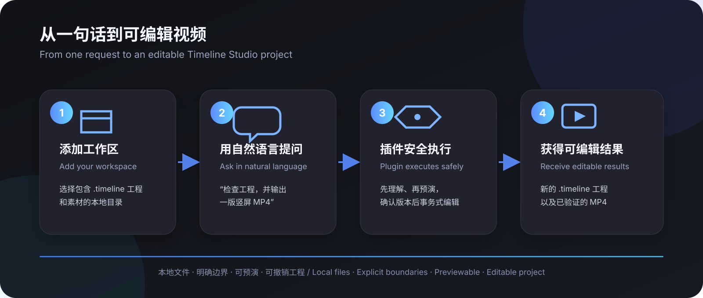
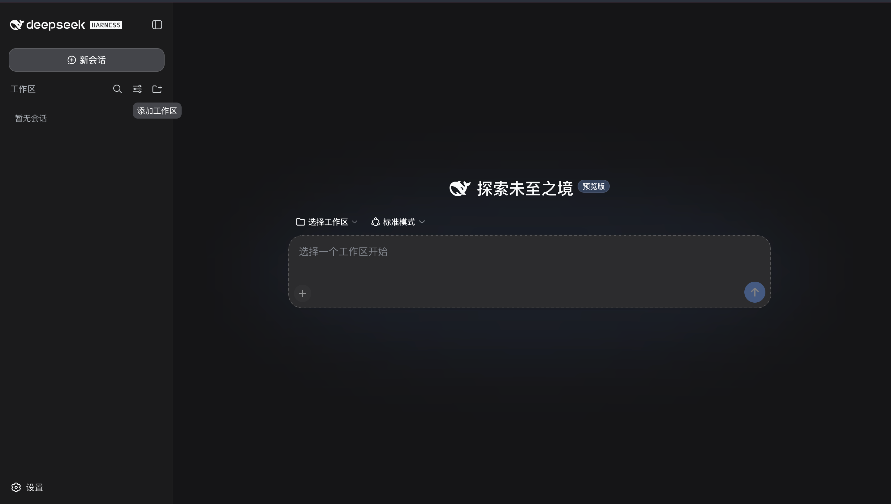
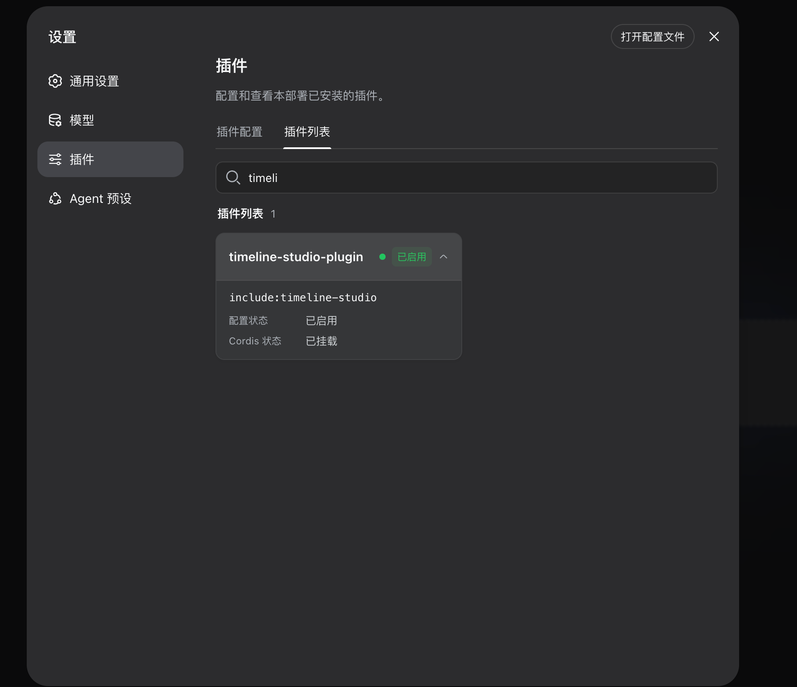
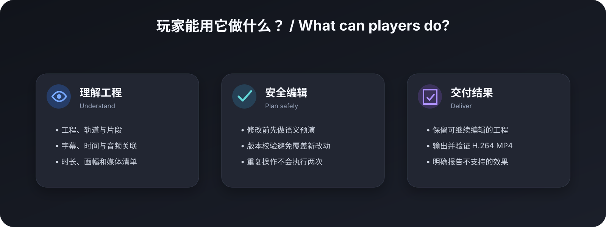

# Timeline Studio for DeepSeek Harness

English | [简体中文](README.zh-CN.md)

`dsh-timeline-studio-plugin` connects DeepSeek Harness to Timeline Studio's deterministic `.timeline` command layer. It also bundles the `edit-timeline-studio` Agent Skill, so the agent receives both executable tools and the workflow rules needed to use them safely.

> **This plugin is built on [Timeline Studio](https://github.com/MartinDelophy/ai-video-editor).** Timeline Studio is the core video editor behind the visual timeline, media processing, browser-local AI capabilities, and complete creation experience. This repository provides the agent automation bridge between that editor and DeepSeek Harness. To explore the full product, see the editor UI, or contribute to its core features, visit the **[Timeline Studio main repository](https://github.com/MartinDelophy/ai-video-editor)**.



## For players: what is it?

This is not another video-editor interface. It is an action bridge between DeepSeek Harness and Timeline Studio. Describe the result you want in Harness, and the agent can inspect a local `.timeline` project, preview changes before applying them, and produce a new editable project plus an MP4. The source project is not overwritten by default.

Don't have Timeline Studio yet? Start with the **[Timeline Studio main repository](https://github.com/MartinDelophy/ai-video-editor)** to get the editor. This plugin does not replace the editor runtime; it calls the `.timeline` command and rendering capabilities provided by the main project.



The screen above is where you begin:

1. Click the **Add workspace** icon beside the Workspaces heading.
2. Select the local folder containing your `.timeline` project and media.
3. Start a **New chat** and describe the outcome you want. The agent invokes the plugin automatically when needed.

### Confirm that the plugin is active

Open **Settings → Plugins → Plugin list**, then search for `timeline`:



The green **Enabled** state and **Cordis status: Mounted** confirm that Harness has loaded the plugin. `include:timeline-studio` is the mount identifier used by this preview configuration; players do not call it directly—just describe an editing task in a normal conversation.

Try this first:

> Inspect the Timeline Studio project in this workspace. Tell me its duration, aspect ratio, tracks, and media. Do not modify any files yet.

Then try a safe edit and export:

> Change the project to 9:16. Show me the edit preview first; if it is valid, save it as a new project and render an MP4. Do not overwrite the source file.



> [!NOTE]
> The plugin does not add a separate visual panel. Its work appears as tool calls and results in the Harness conversation, then as new `.timeline` and video files. Rich visual preview and browser-only WebGPU generation remain inside the Timeline Studio editor.

## For developers: what is included

- Seven model-facing tools for project, track, clip, and transcript inspection; semantic diff; transactional apply; and verified MP4 rendering.
- Revision checks and idempotent operation IDs for safe project mutation.
- A real filesystem boundary through `allowedRoots`, including symlink-escape protection for inputs and outputs.
- Harness cancellation propagated to the Timeline Studio child process.
- The complete `edit-timeline-studio` Skill under `.dsh/skills`.
- Unit tests and a real DeepSeek Harness/Cordis end-to-end test.

Browser-only WebGPU generation and rich browser rendering remain in the Timeline Studio editor. The plugin reports unsupported operations as tool errors instead of silently dropping them.

## Requirements

- DeepSeek Harness `0.1.0-rc.6` Developer Preview
- Node.js `22.20+` or `24+`
- A local Timeline Studio checkout with dependencies installed
- FFmpeg and ffprobe for media import and rendering

## Quick start

```sh
cd /absolute/path/dsh-timeline-studio-plugin
npm install
npm link

cd /absolute/path/to/deepseek-harness
npm link dsh-timeline-studio-plugin
```

Add the plugin to the Cordis composition used by your Harness preset:

```yaml
- name: 'dsh-timeline-studio-plugin'
  config:
    timelineStudioRoot: /absolute/path/to/web_player
    allowedRoots:
      - /absolute/path/to/projects
```

`allowedRoots` is an enforced security boundary, not a prompt instruction. Every project, plan, imported asset, and output must resolve inside one of these directories.

The environment-driven example is available at [`config/timeline-studio.cordis.yml`](config/timeline-studio.cordis.yml).

## Agent workflow

1. Load `edit-timeline-studio`.
2. Call `timeline_studio_project_inspect`.
3. Write a versioned edit plan under an allowed root.
4. Call `timeline_studio_project_diff`.
5. Only after a successful diff, call `timeline_studio_project_apply`.
6. Inspect the output project and optionally call `timeline_studio_project_render`.

## Documentation

- [Timeline Studio main repository and full editor](https://github.com/MartinDelophy/ai-video-editor)
- [Installation and integration](docs/integration.md) · [安装与接入](docs/integration.zh-CN.md)
- [Tool reference](docs/tools.md) · [工具参考](docs/tools.zh-CN.md)
- [Testing and verified results](docs/testing.md) · [测试与验证结果](docs/testing.zh-CN.md)

## Development

```sh
npm run check
TIMELINE_STUDIO_ROOT=/absolute/path/to/web_player npm run test:e2e
```

DeepSeek Harness is still a Developer Preview and may introduce compatibility-breaking changes. This project pins the tested rc.6 packages and keeps editing logic in Timeline Studio so the Harness adapter remains thin.

## Responsible use notice

Use only face and identity media that you own or are explicitly authorized to use. Do not create illegal, infringing, false, misleading, or identity-abusive content, and never present synthetic output as real footage. Users who violate these requirements are solely responsible for their actions and resulting harm.
